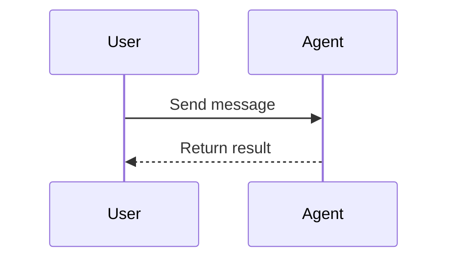

# Sample Chapter

This is a small document for the self-test; see the official docs.

## Message Structure

| Field | Meaning |
| --- | --- |
| `role` | Role |
| `content` | Content |

```ts
// Create a user message
const message = { role: 'user', content: 'Hello' };
sendMessage(message);
```

Run Flow

```text
User input
   │
   ▼
Agent Loop ──► Tool call
```

### Sequence Diagram




> Note: tool calls can run in parallel.
