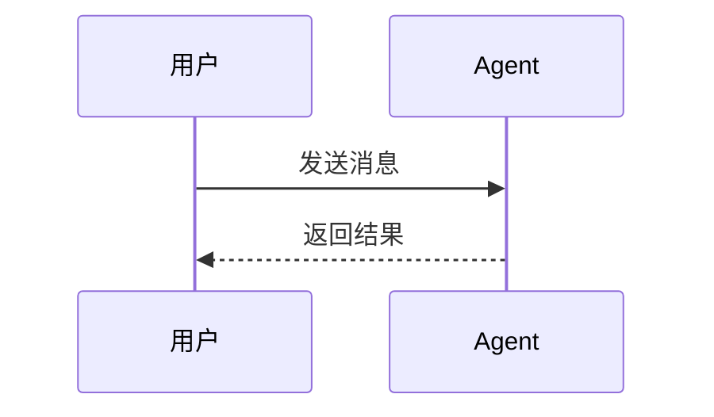

# 示例章节

这是一个用于自测的小文档，参见 [官方文档](https://example.com/docs)。

## 消息结构

| 字段 | 含义 |
| --- | --- |
| `role` | 角色 |
| `content` | 内容 |

```ts
// 创建一条用户消息
const message = { role: 'user', content: '你好' };
send(message);
```

## 运行流程

```text
用户输入
   │
   ▼
Agent Loop ──► 工具调用
```

### 时序图




> 注意：工具调用可以并行执行。
